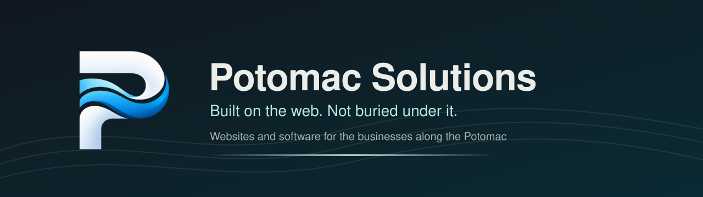

A two-person web studio in Gormania, West Virginia, where the Potomac begins.

[**potomac.solutions**](https://potomac.solutions) · [Services](https://potomac.solutions/services/) · [Our work](https://potomac.solutions/work/) · [Get in touch](https://potomac.solutions/contact/)

---

## We're Mikey and Jayanti

We're a mom-and-pop shop raising our son near the headwaters of the Potomac, and building websites and software for the businesses downstream.

**Mikey Nichols** grew up in Bayard and Gormania. He spent years behind a sales counter building the tools the shop actually needed, and now does the same for other businesses: turning what you have in mind into something that works.

**Jayanti Nichols** holds a master's in Information Systems from Northeastern University. Her focus is cloud computing and security, so what we build is set up properly and kept safe.

When you call, you get one of us.

## What we do

| | | |
| --- | --- | --- |
| 🌐 **Landing page** **Free, always.** A real page for your business at `yourname.potomac.solutions`, or we send you the files. | 💬 **Talk it through** First 30 minutes free, then $75/hr. Bring a problem, leave with a plain answer. | 🧭 **Website + ongoing support** $50/mo or $500/yr. A multi-page site, kept current, with hosting and backups. |
| 📣 **Social media** $50/mo or $500/yr. Facebook, Instagram and LinkedIn, mirrored to a blog on your own site. | ⚙️ **Custom applications** Roughly $1k–$5k by complexity, including n8n automations. Written quote within two business days. | 🔗 **Domain names** At cost plus $10/yr. We register and manage it, and it stays yours. |

Prices are public, and anything beyond the free page gets a written quote before paid work begins. See the [full services page](https://potomac.solutions/services/).

## How we work

- **We talk first.** Your goals matter more than the technology. You tell us what you think you need, and we shape a plan in plain language.
- **Fast, reliable, built to last.** Sites that work on any device, with useful HTML before any JavaScript.
- **Yours to keep.** Your domain stays yours, and what we build can be handed over.
- **Evidence over claims.** No invented testimonials, customer counts or promised results. We show real projects, and the source is public.
- **Open tools keep prices low.** We build with tools we made ourselves and share freely, so the next business pays less.

We're framework-agnostic in client work (WordPress, Shopify, React and plain HTML are all fine) and standards-first in our own engineering.

## Real work

| Project | What it is |
| --- | --- |
| [**Better Days Towing**](https://github.com/Potomac-Solutions/better-days-towing) | A one-page site for a 24/7 Western Maryland towing company, built so a stranded driver can call in one tap. |
| [**Garrett County Adventures**](https://garrettcountyadventures.com) | A trip-planning site with local guides, an interactive map, trail data and browser-local GPX analysis (Rust/WASM). |
| [**Nu Finish Collision Center**](https://github.com/jayanti-neu/nu-finish-site) | A collision-repair site for Oakland, MD, opening January 1, 2027. |

## Writing

We teach what we build. Mikey writes at **[Journey to Code](https://journeytocode.io)** about JavaScript, Web Components, Git, Rust and WebAssembly, and application architecture.

**Featured series**

- [**Commit to Success: Mastering Git**](https://journeytocode.io/series/learn-git-from-basics-to-advanced): moving beyond basic commands to master version control, branches, merging and real-world collaboration.
- [**Journey to Web Components**](https://journeytocode.io/series/web-components-fundamentals-to-advanced): reusable UI without heavy frameworks, using Custom Elements, Shadow DOM and native browser APIs.
- [**Mastering the Fetch API & Browser Storage**](https://journeytocode.io/series/mastering-fetch-api-browser-storage): network requests, IndexedDB, the Cache API and resilient offline-first design.
- [**Mastering the Web Audio API**](https://journeytocode.io/series/complete-web-audio-api-tutorial): creative coding, spatial audio, synthesis and processing in the browser.
- [**Coding Patterns Demystified**](https://journeytocode.io/coding-patterns-demystified): a deep dive into Model-View-Controller with shipping code.

**Recent articles**

Synced automatically from journeytocode.io by a GitHub Action.

<!-- BLOG-POST-LIST:START -->
- [One Message Is Not a Conversation](https://journeytocode.io/one-message-is-not-a-conversation/) — Keep a Rust TCP client and server talking until quit, using loop, break, continue and the zero-byte read that means the...
- [The Input That Never Got Submitted](https://journeytocode.io/a-custom-input-that-joins-the-form/) — Build a custom form field the browser actually submits, resets and blocks on bad input, using formAssociated and Element...
- [A Server With Nobody to Talk To](https://journeytocode.io/a-server-with-nobody-to-talk-to/) — Build a Rust TCP server and client, send one welcome message across localhost and let Result and the question-mark opera...
- [The File That Exists Twice](https://journeytocode.io/the-file-that-exists-twice/) — Our practicum team never fixed a merge conflict that kept coming back. The cause was one file with two names in Git. See...
- [The Tutorial Is Not the Game.](https://journeytocode.io/the-tutorial-is-not-the-game/) — Turn a finished Rust tutorial into a welcoming open-source project, then take one small contribution from idea to pull r...
<!-- BLOG-POST-LIST:END -->

[Read more at journeytocode.io →](https://journeytocode.io)

---

## Our open-source tools

| Tool | What it does |
| --- | --- |
| [**Zubra**](https://github.com/zubra-js/zubra) | A Rust/WASM compiler for web components. Write them like HTML and get server-rendered output that works in plain HTML, React, Vue, Svelte and Angular. |
| [**Zubra UI**](https://github.com/zubra-js/zubra-ui) | 96 accessible components you copy into a project and own. |
| [**open.blog**](https://github.com/journey-to-code-org/open.blog) | An open-source blogging platform. It runs our own blog, [Notes from the river](https://potomac.solutions/notes/). |
| [**kit**](https://github.com/Potomac-Solutions/kit) | Shared server modules for our platforms, built on Zubra. |
| [**potomac-hq**](https://github.com/Potomac-Solutions/potomac-hq) | The software we run our own business on. |

## Demo apps

Made-up businesses with working software behind them, so you can see what's possible and read how each one is built. Want one catered to your business? The foundation is already laid, so it costs less.

[**front-desk**](https://github.com/Potomac-Solutions/front-desk) (online booking, multi-tenant) · [**outfitter**](https://github.com/Potomac-Solutions/outfitter) (rentals and waivers) · [**CineStack**](https://github.com/Potomac-Solutions/CineStack) (seat-picking tickets) · [**tailgate**](https://github.com/Potomac-Solutions/tailgate) (farm-to-door market) · [**showroom**](https://github.com/Potomac-Solutions/showroom) (antiques and consignment) · [**work-ticket**](https://github.com/Potomac-Solutions/work-ticket) (live job tracking) · [**counter**](https://github.com/Potomac-Solutions/counter) (order-ahead bakery) · [**apex-auto**](https://github.com/Potomac-Solutions/apex-auto) (parts-counter call desk)

---

**Have a business and an idea?** Your first landing page is free.

[**Start with a free page →**](https://potomac.solutions) · [Send us a brief](https://potomac.solutions/contact/)

Potomac Solutions · Gormania, West Virginia

